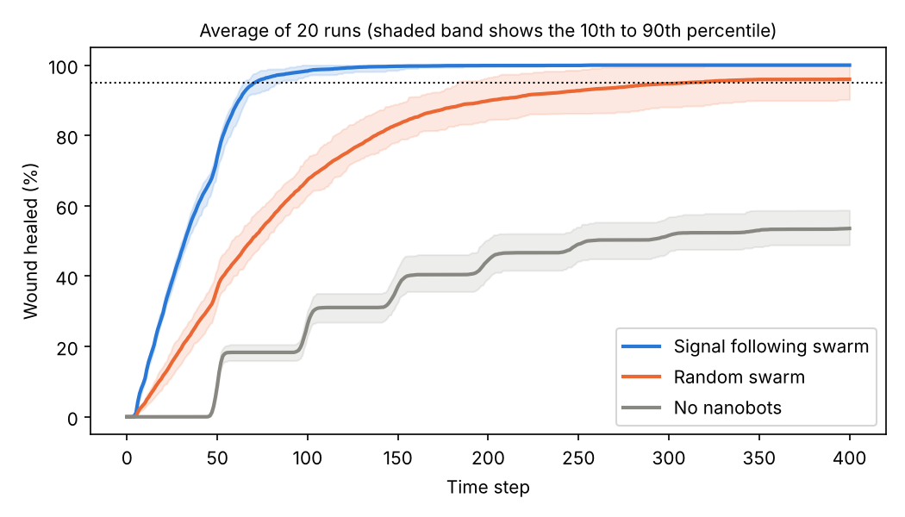
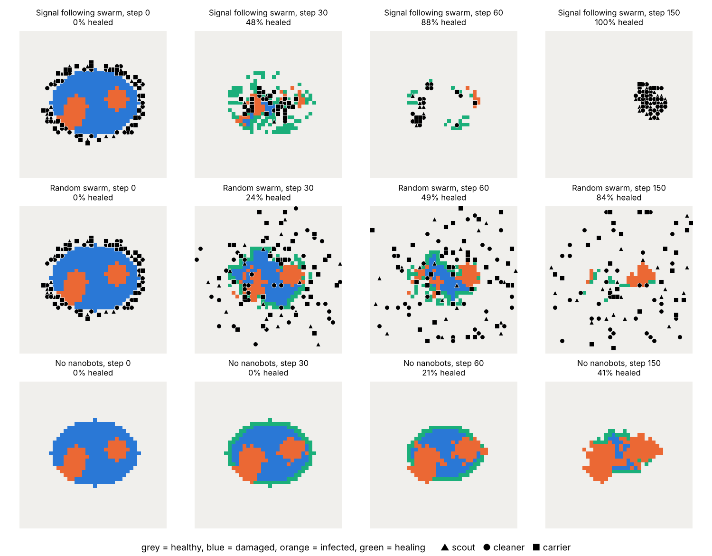
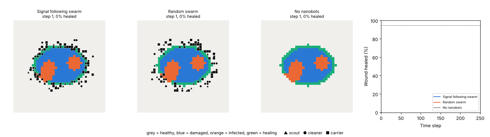

# Nanobot Swarm for Wound Healing: Comparing Healing Time

**Report:** [Project-Report-1.pdf](https://github.com/Nowkee/M8S_Assignment/blob/main/Report/Project-Report-1.pdf)

## 1. Aim

In our proposal we said that the first thing we wanted to find out was whether a swarm of nanobots following chemical signals can make a skin wound heal faster. To test this we built a small agent based model (ABM) in Python using the Mesa library and compared the healing time for three cases:

1. a swarm that follows chemical signals,
2. the same swarm but moving randomly,
3. no nanobots at all.

## 2. The Model

**The wound.** The skin is a 40 by 40 grid. An oval in the middle (331 squares) is the wound. Like in our proposal, every square is either healthy, damaged, infected or healing. At the start, four round patches of infection (about 90 squares in total) are placed randomly inside the wound. Bacteria grow a little every step and can spread to open squares next to them. The body still does some work by itself: it slowly kills a small amount of bacteria and closes the wound from the healthy edges inwards. However, it cannot heal a square while it is infected.

**The chemical signal.** Every square that is not healthy gives off a signal. Each step the signal spreads to the 8 neighbouring squares and fades slightly, so it is strongest close to the damage.

**The nanobots.** We used 100 nanobots placed in a gel ring around the wound edge, split into the three roles from our proposal: 20 scouts, 40 cleaners and 40 carriers. Each nanobot is a Mesa agent, and every step it either does its job on the square it is standing on or moves to one of its 8 neighbouring squares.

<table>
<tr><th>Role</th><th>What it does in the model</th></tr>
<tr><td>Scout</td><td>Drops a marker on any unhealed square it visits so others are drawn there</td></tr>
<tr><td>Cleaner</td><td>Stays on an infected square and kills 0.2 of the bacteria each step</td></tr>
<tr><td>Carrier</td><td>Stays on a clean but unhealed square and adds growth factor so it heals faster</td></tr>
</table>

The five rules from our proposal are all in the code. The nanobots move towards the strongest signal plus marker, but take a random step 15% of the time to explore (rule 1). Squares that already have bots on them are less attractive (rule 2). Carriers only work on squares that are no longer infected (rule 3). Healed squares stop giving off a signal (rule 4). Finally, every bot has 300 steps of fuel and 30 doses of medicine and is removed once either runs out (rule 5).

The only difference between the signal swarm and the random swarm is the movement. Below is the part of the code that decides where a bot moves. For the random swarm the first `if` is always true.

```python
def move(self):
    m = self.model
    options = m.grid.get_neighborhood(self.pos, moore=True)
    if m.mode == "random" or self.random.random() < 0.15:
        m.grid.move_agent(self, self.random.choice(options))
        return
    def score(cell):
        crowd = len(m.grid.get_cell_list_contents([cell]))
        return m.signal[cell] + m.marker[cell] - 0.3 * crowd
    best = max(score(c) for c in options)
    m.grid.move_agent(self, self.random.choice([c for c in options if score(c) == best]))
```

**How we measured it.** We took the healing time as the number of steps until 95% of the wound was healthy again. Each case was run 20 times with different random wounds (seeds 0 to 19). The same 20 wounds were used for all three cases so the comparison is fair. Every run lasted 400 steps.

## 3. Results



_Figure 1: Average percentage of the wound healed over time. The dotted line is the 95% finish line._

<table>
<tr><th>Case</th><th>Runs that reached 95% (out of 20)</th><th>Mean healing time (steps)</th><th>Fastest and slowest run</th><th>Healed after 400 steps</th><th>Infected squares after 400 steps</th></tr>
<tr><td>Signal following swarm</td><td>20</td><td>72.5 (sd 8.5)</td><td>64 and 98</td><td>100%</td><td>0</td></tr>
<tr><td>Random swarm</td><td>13</td><td>242.2 (sd 45.7)</td><td>181 and 321</td><td>96.0%</td><td>13.3</td></tr>
<tr><td>No nanobots</td><td>0</td><td>did not heal</td><td>none</td><td>53.6%</td><td>153.4</td></tr>
</table>

_Table 1: Results from 20 runs of each case. The random swarm time is only the average of the 13 runs that made it to 95%._



_Figure 2: The same wound (seed 3) under each case at steps 0, 30, 60 and 150. Triangles are scouts, circles are cleaners and squares are carriers._



_Figure 3: Live view of the same wound being treated by each case at the same time, with the healing graph updating as the run goes on. The nanobot shapes are the same as in Figure 2._

**Signal following swarm.** This was clearly the fastest. It reached 95% healed in every run, on average in 72.5 steps, and by the end there was no infection left. In Figure 2 the bots quickly pile onto the orange infected patches and the blue damaged area, so the wound heals from the inside as well as from the edges.

**Random swarm.** It still helped compared to doing nothing, but it was about 3.3 times slower (242.2 steps) and only reached the finish line in 13 out of 20 runs. The real gap is actually bigger than this, because the 7 failed runs are not included in the average. Figure 2 shows why: the random bots drift away into healthy skin, where they are useless, and use up their fuel there. Some infection was still left at the end.

**No nanobots.** The wound never healed. In Figure 1 the grey line goes up in steps, as each ring of the wound edge closes, but it gets stuck at around 54%. Meanwhile the infection grew from about 90 to about 153 squares and blocked the rest of the healing. This acts like a chronic wound, which is the problem our proposal is about.

## 4. Discussion and Limitations

The results support the idea in our proposal: one nanobot alone can do very little, but a swarm following simple local rules finds the damage by itself and heals the wound much faster. Since the random swarm had exactly the same bots, fuel and medicine, the big difference is caused only by following the chemical signal. There is no leader telling the bots where to go, and the group behaviour comes from each bot reacting to what is next to it, just like the immune cells described in our background.

There are some limits to our model. Firstly, all the numbers (bacteria growth, fuel, doses and so on) were picked by us so that the model behaves sensibly, so the exact step counts should not be taken as real time. Secondly, the model is flat and ignores blood flow, as we said in our proposal. Lastly, in the step 150 picture of the signal swarm, the bots clump together after the wound has healed, because the signal takes a while to fade. This does not affect healing time, but in a real treatment those bots would be wasted.

## 5. Conclusion

The signal following swarm healed the wound in every run and was about 3.3 times faster than the random swarm, while the wound with no nanobots never healed and the infection kept spreading. This shows that the way the swarm moves matters as much as having the nanobots there in the first place.

## How to run

```
pip install mesa numpy matplotlib pillow
python swarm.py
```

This prints the results in Table 1 and saves `healing_curves.png` and `snapshots.png`. It takes about 30 seconds.

To watch the experiment run live (Figure 3), run this from a terminal or VS Code (it does not work inside Jupyter):

```
python live_view.py
```

A window opens showing the signal swarm, the random swarm and the wound with no nanobots side by side, with the healing graph on the right. Changing `SEED` at the top of the file gives a different wound. Running `python live_view.py gif` saves the animation as `live_view.gif` instead.

## References

1. R. Wu, Y. Zhu, X. Cai, S. Wu, L. Xu, and T. Yu, "Recent process in microrobots: From propulsion to swarming for biomedical applications," _Micromachines_, vol. 13, no. 9, Art. no. 1473, 2022.
2. S. Guo and L. A. DiPietro, "Factors affecting wound healing," _J. Dent. Res._, vol. 89, no. 3, pp. 219 to 229, 2010.
3. Mesa: Agent based modeling in Python, https://mesa.readthedocs.io
