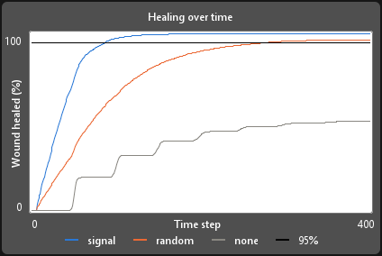
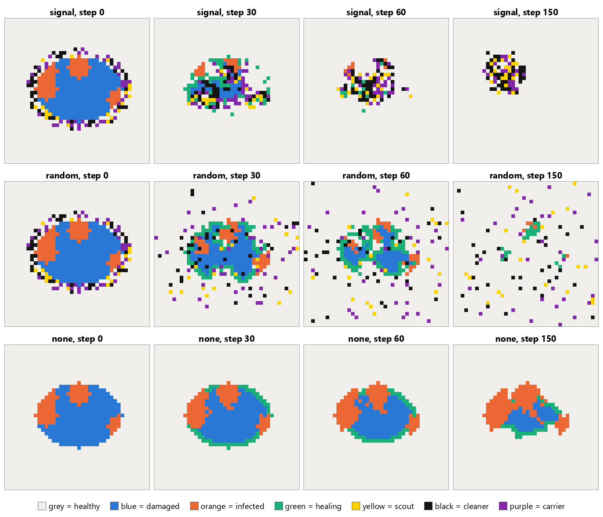

# Nanobot Swarm for Wound Healing: A Cellular Automaton in NetLogo

**Model:** [wound_ca.nlogox](wound_ca.nlogox) (NetLogo 7)

**Report:** [Project-Report-2.pdf](../Report/Project-Report-2.pdf)

## 1. Aim

In our [First Submission](../First-Submission/) we built an agent based model in Python and found that a nanobot swarm following chemical signals heals a skin wound much faster than a swarm moving randomly, and that the wound never heals with no nanobots. For this submission we took that small part of our project and rebuilt it as a cellular automaton (CA) in NetLogo. We wanted to see if the same result still holds when the nanobots are no longer free agents but just one more piece of state inside each cell of the grid. We compared the same three cases:

1. a swarm that follows chemical signals,
2. the same swarm but moving randomly,
3. no nanobots at all.

## 2. The Model

**What a cellular automaton is.** A cellular automaton is a grid of cells where every cell has one of a few states, and at each step every cell updates at the same time using only its own state and the states of its neighbours. This is the same idea used to model the spread of wildfires (Freire and DaCamara, 2019), where each cell is a piece of land that is unburnt, burning or burnt.

**The cells.** The skin is a 40 by 40 grid of NetLogo patches with no wrapping, and there are no turtles at all. As before, an oval in the middle (331 cells) is the wound and every cell is healthy, damaged, infected or healing. Four round patches of infection (radius 3, bacteria 0.6) are placed randomly inside the wound. Each cell also stores its bacteria level, healing progress, chemical signal and scout marker.

**The tissue rule.** We kept every number from the Python model. Bacteria on an infected cell grow by 0.02 x b x (1 - b) and the body kills 0.004 per step. A cell with no bacteria left goes back to damaged. Infection can jump to an open (damaged or healing) cell with probability 0.01 x pressure, where the pressure comes from the bacteria in the 8 neighbours. The body heals open cells next to healthy tissue by 0.02 x a random number between 0.5 and 1.5, and a cell becomes healthy when its healing reaches 1, as long as it is not infected.

**The chemical signal.** Every unhealed cell gives off 1 unit of signal per step. Each cell then keeps half of its signal, takes an equal share of the other half from its 8 neighbours, and fades by 5%. Healed cells stop giving off a signal (rule 4), and scout markers spread the same way but are wiped on healthy cells.

**The nanobot layer.** Instead of agents, each cell also has a bot role (none, scout, cleaner or carrier), fuel and medicine. At the start, 100 bots (20 scouts, 40 cleaners and 40 carriers) are placed on random cells in a gel ring up to 2 cells outside the wound. A cell can only hold one bot, which is our version of rule 2 (crowding).

<table>
<tr><th>Role</th><th>What it does in the model</th></tr>
<tr><td>Scout</td><td>Adds 2 to the marker of any unhealed cell it is on, then keeps moving</td></tr>
<tr><td>Cleaner</td><td>Stays on an infected cell and kills 0.2 of the bacteria each step</td></tr>
<tr><td>Carrier</td><td>Stays on a clean but unhealed cell and adds 0.25 healing each step (rule 3)</td></tr>
</table>

Every bot has 300 steps of fuel and 30 doses of medicine, and the cell drops its bot once either runs out (rule 5).

**Moving bots in a CA.** A bot that did not work this step picks one empty neighbour as its target. It picks a random one 15% of the time, or always in the random swarm, and otherwise picks the one with the highest signal plus marker, with ties broken randomly (rule 1). Then every empty cell looks at the bots around it that picked it and pulls in exactly one of them at random. Bots that lose stay where they are. Because a cell only ever pulls in one bot, two bots can never end up on the same cell. Below is the part of the code where a bot picks its target. The only difference between the signal swarm and the random swarm is the first `if`.

```
to-report pick-target
  let free neighbors with [ bot-role = 0 ]
  if not any? free [ report nobody ]
  if mode = "random" or random-float 1 < 0.15 [ report one-of free ]
  let best max [ signal + marker ] of free
  report one-of free with [ signal + marker = best ]
end
```

**Synchronous update.** Each step has the same three phases as the Python model: the tissue, then the signal and markers, then the bots. Inside each phase, every cell first works out its next values from the current grid, and only then do all cells switch to the new values at once. Nothing is changed in place while the other cells are still reading the grid.

**How we measured it.** As before, the healing time is the first step where 95% of the wound is healthy. Each case was run with seeds 0 to 19, so all three cases used the same 20 wounds. Every run lasted 400 steps. All the numbers below come from NetLogo, from a BehaviorSpace experiment and from a `run-experiment` procedure that works out the summary.

## 3. Results



_Figure 1: The "Healing over time" plot from NetLogo after `run-experiment`. It shows the average percentage of the wound healed over 20 runs of each case. The black line is the 95% finish line._

<table>
<tr><th>Case</th><th>Runs that reached 95% (out of 20)</th><th>Mean healing time (steps)</th><th>Fastest and slowest run</th><th>Healed after 400 steps</th><th>Infected cells after 400 steps</th></tr>
<tr><td>Signal following swarm</td><td>20</td><td>86.9 (sd 4.9)</td><td>76 and 95</td><td>100%</td><td>0</td></tr>
<tr><td>Random swarm</td><td>15</td><td>243.9 (sd 48.7)</td><td>174 and 339</td><td>96.6%</td><td>11.1</td></tr>
<tr><td>No nanobots</td><td>0</td><td>did not heal</td><td>none</td><td>50.5%</td><td>162.8</td></tr>
</table>

_Table 1: Results from 20 runs of each case. The random swarm time is only the average of the 15 runs that made it to 95%._



_Figure 2: The same wound (seed 3) under each case (rows: signal, random, none) at steps 0, 30, 60 and 150 (columns). Grey is healthy, blue is damaged, orange is infected and green is healing. Yellow cells hold a scout, black cells a cleaner and purple cells a carrier._

**Signal following swarm.** This was again clearly the fastest. It reached 95% healed in every run, on average in 86.9 steps, and no infection was left at the end. It was also very steady, with only 19 steps between the fastest and slowest run. In Figure 2 the bots move into the wound within the first 30 steps and spread over the infected and damaged cells, so the wound heals from the inside as well as from the edges.

**Random swarm.** It helped compared to doing nothing, but it was about 2.8 times slower (243.9 steps) and only reached the finish line in 15 out of 20 runs. As in the First Submission, the real gap is bigger, because the 5 failed runs are not in the average. Figure 2 shows the bots spreading out into healthy skin, where they are useless, while infected cells are still left in the wound.

**No nanobots.** The wound never healed. The grey line in Figure 1 goes up in steps as each ring of the wound edge closes, then gets stuck at around 50%. The infection grew from about 94 to about 163 cells and blocked the rest of the healing, just like a chronic wound.

## 4. Discussion and Limitations

The CA gives the same answer as our Python ABM. The order is the same (signal, then random, then no nanobots), and the numbers are close. The table below puts the two side by side.

<table>
<tr><th>Case</th><th>Python ABM (First Submission)</th><th>NetLogo CA (this submission)</th></tr>
<tr><td>Signal following swarm</td><td>20/20 runs, 72.5 steps</td><td>20/20 runs, 86.9 steps</td></tr>
<tr><td>Random swarm</td><td>13/20 runs, 242.2 steps, 96.0% healed</td><td>15/20 runs, 243.9 steps, 96.6% healed</td></tr>
<tr><td>No nanobots</td><td>0/20 runs, 53.6% healed, 153.4 infected</td><td>0/20 runs, 50.5% healed, 162.8 infected</td></tr>
</table>

The signal swarm is about 14 steps slower in the CA, so the gap to the random swarm drops from about 3.3 times to about 2.8 times. We think this comes from the one bot per cell rule. In the Python model several carriers could pile onto the same square and add their healing together, and several cleaners could work on the same infected square. In the CA only one bot can work on a cell, so the swarm has to spread out more. The random swarm barely changes, because random bots almost never meet on the same square anyway. The no nanobots case only depends on the tissue rule, and its small differences come from the random wounds.

There are a few other small differences from `swarm.py`:

- In Python, bots act one after another in a random order, so a bot can see where earlier bots moved or what markers they dropped in the same step. In the CA every bot sees the same grid, and a scout's marker only counts from the next step.
- Python lowers the score of crowded squares by 0.3 per bot. In the CA a bot simply cannot target an occupied cell, and if two bots want the same empty cell, one of them stays put.
- In Python several bots could start on the same square of the gel ring. In the CA each starts on its own cell.
- NetLogo and Python use different random number generators, so seed 3 here is not the same wound as seed 3 in the First Submission. The 20 wounds are different, but the same 20 are used for all three cases.
- Figure 1 shows only the average curves, without the 10th to 90th percentile band, because NetLogo plots cannot shade between lines.

The limitations of the First Submission still apply. All the numbers were picked by us, so the step counts are not real time, and the model is flat with no blood flow. The CA also has its own limit: a bot is only allowed to see and move into the 8 cells next to it, which is stricter than a real nanobot drifting in fluid. Like in the Python model, the signal bots clump together in the middle after the wound has healed (Figure 2, step 150) until their fuel runs out.

## 5. Conclusion

Rebuilt as a cellular automaton with only local rules and synchronous updates, the signal following swarm still healed the wound in every run and was about 2.8 times faster than the random swarm, while the wound with no nanobots never healed. The one bot per cell rule made the swarm a little slower than in our Python model, but the main result did not change: how the swarm moves matters as much as having the nanobots there at all.

## How to run

1. Install [NetLogo 7](https://ccl.northwestern.edu/netlogo/) and open `wound_ca.nlogox` (File, then Open).
2. Pick a `mode` (signal, random or none) and a `seed`, then press `setup` and `go`. The run stops at 95% healed while `stop-at-95?` is on, and always stops at 400 steps.

To rerun the whole experiment, press `run-experiment`. It runs the 3 cases with seeds 0 to 19, draws the average curves in the "Healing over time" plot, prints the summary in the Command Center and writes `results/summary.txt`, `results/healing_curves.csv`, `results/healing_curves.png` (a picture of the whole interface) and the 12 snapshots. It takes about a minute and a half. Then `python make_figures.py` crops the "Healing over time" plot out of `healing_curves.png` and puts the 12 snapshots together into `results/snapshots.png`. This script needs Pillow and only crops and arranges the NetLogo pictures. Every number comes from NetLogo.

The table of every run (`results/experiment-table.csv`) comes from the BehaviorSpace experiment `ca-experiment` (Tools, then BehaviorSpace). It can also be run without the interface from this folder:

```bash
"/c/Program Files/NetLogo 7.0.4/NetLogo_Console.exe" --headless --model wound_ca.nlogox --experiment ca-experiment --table results/experiment-table.csv
```

The experiment `summary` runs `run-experiment` the same way, except for `healing_curves.png`, because NetLogo can only save the interface as a picture when the interface is open.

## References

1. R. Wu, Y. Zhu, X. Cai, S. Wu, L. Xu, and T. Yu, "Recent process in microrobots: From propulsion to swarming for biomedical applications," _Micromachines_, vol. 13, no. 9, Art. no. 1473, 2022.
2. S. Guo and L. A. DiPietro, "Factors affecting wound healing," _J. Dent. Res._, vol. 89, no. 3, pp. 219 to 229, 2010.
3. Mesa: Agent based modeling in Python, https://mesa.readthedocs.io
4. J. G. Freire and C. C. DaCamara, "Using cellular automata to simulate wildfire propagation and to assist in fire management," _Nat. Hazards Earth Syst. Sci._, vol. 19, no. 1, pp. 169 to 179, 2019.
5. U. Wilensky, NetLogo, Center for Connected Learning and Computer-Based Modeling, Northwestern University, 1999, https://ccl.northwestern.edu/netlogo/
